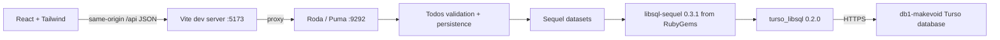

# Architecture

## Request path

Roda serves JSON only, including JSON errors for unknown routes. Vite owns HTML, assets, React development, and hot reload. The API has no frontend rendering or asset routes.

## Backend modules

- `app.rb`: Roda routing, JSON parsing, media type/body-size checks, origin checks, and sanitized error responses. `App.build(db:)` injects a database for isolated tests.
- `lib/database.rb`: URL/token resolution, a four-connection Sequel pool, and migration entry point.
- `lib/todos.rb`: the task repository and validation. Uses Sequel-generated SQL, UUID primary keys, and UTC ISO 8601 timestamps. Updates use SQLite `RETURNING` to avoid a follow-up read.
- `db/migrations/`: versioned schema changes. A dedicated migration table avoids sharing another application's migration history.
- `config.ru`: connects/migrates before serving and disconnects at exit.
- `config/puma.rb`: loopback server, four threads, no worker forks.
- `bin/dev`: supervises both development servers and their child process groups.

`daylight_todos` stores title, notes, list, importance, optional due date, completion, and timestamps. List and priority are checked by both API validation and SQL constraints. Completion/creation and list indexes support future server-side querying. Dates are calendar `YYYY-MM-DD` strings; timestamps are UTC strings. This avoids timezone shifts in due dates and is compatible with the native adapter's type handling.

## JSON API

| Method | Path | Successful response |
| --- | --- | --- |
| GET | `/api/health` | `200 {"status":"ok"}` after a real DB query |
| GET | `/api/todos` | `200 {"todos":[...]}` |
| POST | `/api/todos` | `201 {"todo":{...}}` |
| GET | `/api/todos/:id` | `200 {"todo":{...}}` |
| PATCH | `/api/todos/:id` | `200 {"todo":{...}}` |
| DELETE | `/api/todos/:id` | `200 {"deleted":true}` |

Create/update JSON fields:

| Field | Contract |
| --- | --- |
| `title` | Required on create; trimmed, 1–240 characters |
| `notes` | Text, at most 4,000 characters; default empty |
| `list` | `personal`, `work`, or `life`; default `personal` |
| `priority` | `normal` or `high`; default `normal` |
| `due_date` | Valid `YYYY-MM-DD` calendar date, or null |
| `completed` | JSON boolean; default false |

IDs and timestamps are generated by the server and cannot be overwritten. Unknown fields, empty updates, and NUL text are rejected. PATCH only changes supplied fields. Each mutation is one SQL statement, so a separate transaction is unnecessary. DELETE permanently removes one identified task.

Errors always use `{"error":"message"}`: 400 malformed JSON, 403 foreign Origin, 404 missing task/route, 413 over 16 KiB, 415 non-JSON mutation body, 422 invalid fields, 503 database failure. Unexpected errors return a generic 500. Database messages/SQL and credentials are not returned or logged; only failure class names are logged.

## Frontend modules

- `App.jsx`: workspace shell, navigation, filters, search, sorting, quick entry, task rows, and current-day state.
- `TaskDialog.jsx`: native modal dialog with focus containment, Escape handling, form validation, notes/date/list editing, and two-step deletion.
- `useTodos.js`: initial fetch, pending IDs, mutation state, optimistic updates/deletion with rollback on failure, and server reconciliation.
- `api.js`: JSON fetches, 15-second request deadlines, and API error handling.
- `styles.css`: Tailwind v4 and a small component layer for the visual system. No runtime CSS CDN or remote font requests.

Initial load reads the small personal task collection once. Search, view filters, counts, and sorting run in memory without per-keystroke requests. Toggle/priority/delete feel immediate; the backend remains authoritative. Creation waits for its server-issued ID. UI state is not stored as a substitute database. Refreshing retrieves persisted Turso rows.

The desktop sidebar becomes horizontal navigation on small screens; a bottom action keeps new-task entry available. Touch controls, native form elements, reduced-motion support, labels, and live status updates are included. Dialogs preserve unsaved input after a failed save.

## Scope and tradeoffs

This is a single-user, online-only app. There is no login, sharing, offline queue, or live multi-tab sync. Reload fetches changes made elsewhere. The full collection is loaded for a personal-scale list; very large datasets should move filtering and pagination into the API. Concurrent clients use last-write-wins updates; field-level PATCH reduces unrelated overwrites, but there is no optimistic-lock version column.

An ambiguous network timeout may occur after a write has committed. The UI reports the failure; reload before repeating a create to avoid duplicate tasks. Writes are never automatically retried. The loopback binding, strict JSON mutations, and origin checks are appropriate for local use but are not a replacement for deployment authentication.
